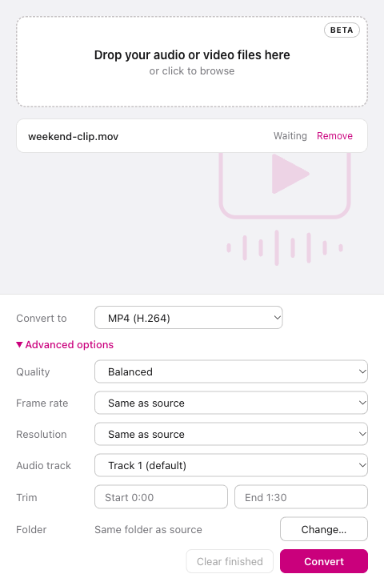

# Kinoshift — Free, offline video & audio converter

<p align="center">
  
</p>

<p align="center">
  Convert video, extract audio, and make GIFs on macOS and Windows.<br />
  <strong>Your media stays on your computer. No cloud uploads. No account required.</strong>
</p>

<p align="center">
  <a href="https://github.com/antinmaze/kinoshift/releases"></a>
  <a href="LICENSE"></a>
  
</p>

<p align="center">
  <a href="https://github.com/antinmaze/kinoshift/releases">Download</a> ·
  <a href="https://antoinemaze.fr/kinoshift/">Website</a> ·
  <a href="#supported-output-formats">Formats</a> ·
  <a href="#quick-start">Quick start</a> ·
  <a href="CONTRIBUTING.md">Contribute</a> ·
  <a href="https://github.com/antinmaze/kinoshift/issues">Report a bug</a>
</p>

**Kinoshift is a free, open-source video converter and audio converter powered by FFmpeg.** Its desktop interface lets you convert to MP4, WebM, MKV, MP3, M4A, WAV, FLAC, OGG, and animated GIF without writing FFmpeg commands. Queue multiple files, choose a preset, and convert locally.

> **Public beta:** bugs and limitations are expected. macOS builds are ad-hoc signed, not Developer ID signed or notarized; Windows installers are not code signed. Your operating system may block or warn about installation. See the [release notes](RELEASE_NOTES.md) before downloading.

## See Kinoshift in action

<p align="center">
  
</p>

## Why Kinoshift?

- **Local, offline conversion:** media is processed on your machine, not uploaded to a conversion service.
- **FFmpeg with a graphical interface:** choose presets instead of memorizing command-line options.
- **Batch workflow:** drag and drop multiple files into a queue; conversions run one at a time.
- **Audio extraction:** turn a video's audio track into MP3, AAC/M4A, WAV, FLAC, or OGG.
- **Video and GIF output:** export H.264 video, VP9 WebM, or a looping animated GIF.
- **Device presets:** profiles for iPhone, iPad, Apple TV, Android, Fire HD, Nintendo Switch, and older devices including iPod and PSP. HEVC/H.265 is available in selected device presets.
- **Useful controls:** trim start/end, adjust quality, frame rate and resolution, select an audio track, or mute video. Available controls depend on the preset.
- **English and French:** localized interface and help, plus light, dark, and system themes.
- **Free software:** GPL-3.0-or-later source code, with unit, integration, and Electron UI tests.

Inspired by the straightforward workflow of Miro Video Converter 3, Kinoshift is an independent project built with Electron and FFmpeg.

## Download for macOS and Windows

**[Get Kinoshift from GitHub Releases →](https://github.com/antinmaze/kinoshift/releases)**

| Your computer | Installer to choose |
| --- | --- |
| Mac with Apple Silicon (M-series) | macOS ARM64 DMG |
| Mac with Intel processor | macOS x64 DMG |
| Windows PC (64-bit Intel/AMD) | Windows x64 EXE installer |

Open the most recent release, including **pre-releases** while Kinoshift is in beta, and expand **Assets** to find the installers. Linux and Windows ARM installers are not currently provided.

**You do not need Node.js or npm to use an installer.** Release builds include FFmpeg. Downloading and installing the app requires an internet connection; media conversion itself runs locally.

## Quick start

1. Install the build matching your operating system and processor.
2. Open Kinoshift and drag in your audio or video files, or use the file picker.
3. Choose an output format or device preset and an output folder.
4. Optionally adjust quality, resolution, audio, or trim settings, then start conversion.

### Common conversion tasks

| What you want to do | Preset or setting |
| --- | --- |
| Convert a compatible MOV or MKV input to MP4 | **MP4 (H.264)** |
| Extract MP3 audio from a video | **MP3** |
| Convert WAV audio to FLAC | **FLAC** |
| Create a WebM video | **WebM (VP9)** |
| Make a looping GIF from video | **Animated GIF** (12 fps, 480 px output width) |
| Prepare video for a phone or tablet | Choose the matching **device preset** |
| Reduce dimensions or trim a clip | Adjust **resolution** or **start/end** in advanced settings |

Input compatibility depends on the codecs and demuxers supported by your FFmpeg build. Reducing quality or resolution can reduce file size, but a smaller output is not guaranteed for every source.

## Supported output formats

| Type | Outputs | Encoding |
| --- | --- | --- |
| Video | MP4, MKV | H.264 + AAC |
| Web video | WebM | VP9 + Opus |
| Device video | MP4 | H.264 or HEVC/H.265, depending on preset |
| Audio | MP3, M4A, WAV, FLAC, OGG | MP3, AAC, PCM, FLAC, Vorbis |
| Animation | GIF | Palette-based looping animation |

## Frequently asked questions

### Is Kinoshift free and open source?

Yes. Kinoshift is distributed under the [GPL-3.0-or-later license](LICENSE). You can inspect the source, modify it, and contribute improvements under that license.

### Does it upload my videos or audio?

No. Conversion runs locally through FFmpeg. No cloud conversion service or user account is required. Links to the website, feedback, and donation services open external sites separately.

### Is this an FFmpeg GUI?

Yes: Kinoshift provides a desktop graphical interface for common FFmpeg conversion tasks. It is not a full video editor or an interface to every FFmpeg option. You can also select your own FFmpeg binary.

### Can I convert several files at once?

You can add multiple files to the queue. Kinoshift processes them sequentially, not in parallel.

### Vous cherchez un convertisseur vidéo gratuit en français ?

Kinoshift est un **convertisseur vidéo et audio libre pour macOS et Windows**. Convertissez vos fichiers en MP4, MP3, WebM ou GIF en local, sans téléverser vos médias. L’interface et l’aide sont disponibles en français et en anglais, selon la langue du système.

## Support and community

- [Report a reproducible bug](https://github.com/antinmaze/kinoshift/issues/new?template=bug_report.yml).
- [Suggest a feature](https://github.com/antinmaze/kinoshift/issues/new?template=feature_request.yml) and explain your use case.
- [Read the contribution guide](CONTRIBUTING.md) to help with tests, accessibility, documentation, or translations.
- If Kinoshift is useful to you, **consider starring this repository** and sharing it with someone who needs a local media converter. Honest feedback and real-world bug reports help just as much.

## Development requirements

- Node.js 22.12 or newer
- npm
- macOS (Apple Silicon or Intel) or Windows x64

## Development setup

```bash
npm install
npm run fetch-ffmpeg
npm start
```

### FFmpeg

FFmpeg binaries are not stored in the repository. In development, the app can also detect an installed FFmpeg or use a manually selected path. The provided script downloads the binaries and validates the SHA-256 hash of each archive:

```bash
npm run fetch-ffmpeg
```

To download binaries for multiple platforms:

```bash
npm run fetch-ffmpeg -- all
```

## Tests

The full test suite requires FFmpeg binaries for the supported platforms, including build verification. Download them before running the checks:

```bash
npm run fetch-ffmpeg -- all
npm test
npm run test:e2e
npm run test:all
```

- `npm test`: unit and integration tests
- `npm run test:e2e`: Electron UI tests
- `npm run test:all`: full test suite

## Building installers

On macOS:

```bash
npm run dist:mac
```

On Windows:

```bash
npm run dist:win
```

The build scripts download the required FFmpeg executables and generate output in the `dist/` folder. The macOS build targets Apple Silicon and Intel DMG images, while the Windows build targets x64 NSIS installers.

## Release publishing

The project is ready to publish GitHub builds for the macOS and Windows installers.

### Create release notes

Use the release notes in [RELEASE_NOTES.md](RELEASE_NOTES.md) for the initial beta publication.

### Publish from the terminal

```bash
npm install
npm run dist
npm run release:github -- 1.0.0
```

This script will:

- build the macOS and Windows installers
- validate that artifacts exist in `dist/`
- create or update the GitHub release for the given version
- attach the generated `.dmg` and `.exe` files to the release

### Manual GitHub publication

If you prefer to publish manually:

```bash
git tag v1.0.0
git push origin main --tags
gh release create v1.0.0 dist/*.dmg dist/*.exe \
  --title "Kinoshift v1.0.0" \
  --notes-file RELEASE_NOTES.md
```

### Release caveats

- macOS beta builds use ad-hoc signing to preserve bundle integrity. They are not Developer ID signed or notarized and may still be blocked by Gatekeeper.
- Windows signing is not configured yet.
- Users may see warnings from the operating system when opening the installer files.

## License

This project is published under the [GPL-3.0-or-later](LICENSE) license. The FFmpeg binaries and their bundled dependencies are subject to their own licenses; provenance information is included with the downloaded binaries.

## Contributing

Contributions, bug reports, and feature suggestions are welcome. See [CONTRIBUTING.md](CONTRIBUTING.md) for setup, testing, and pull request guidance. Maintainers can find repository metadata and an organic outreach checklist in [the discoverability guide](.github/DISCOVERABILITY.md).
